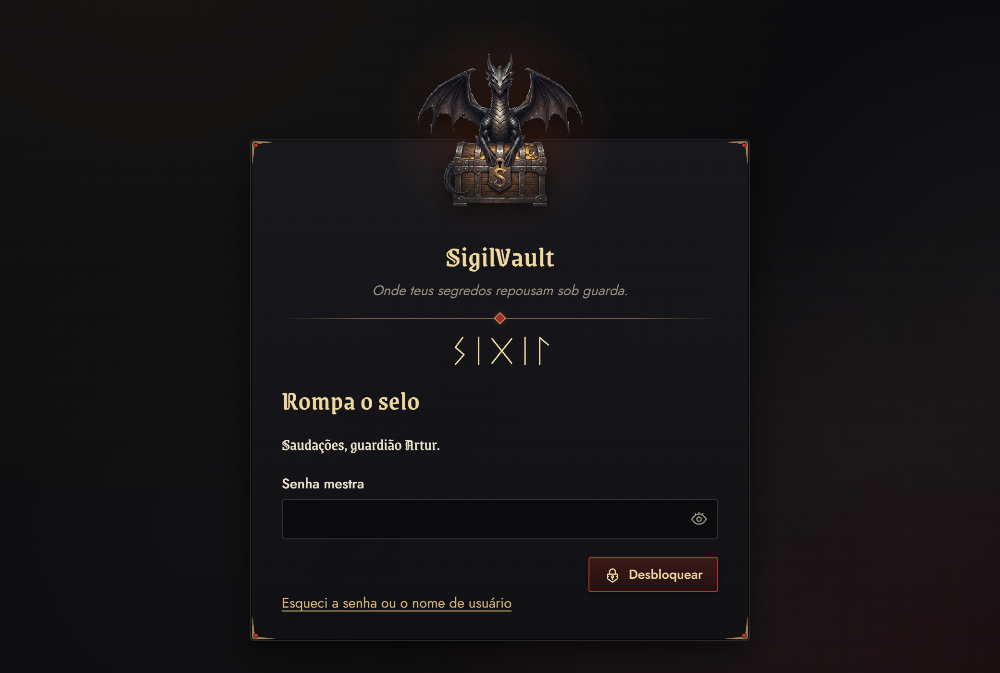
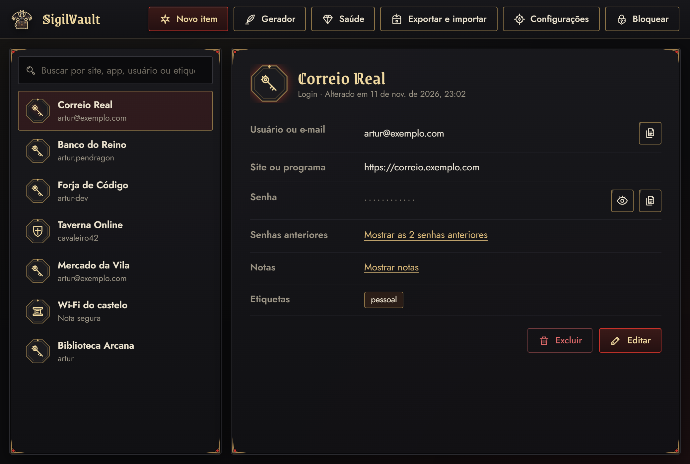
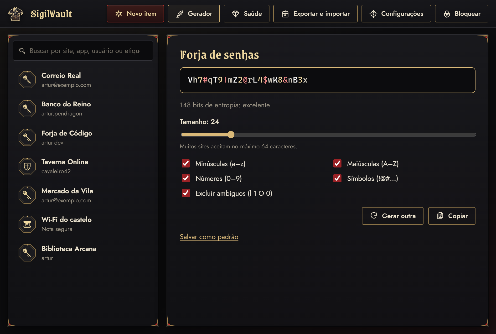
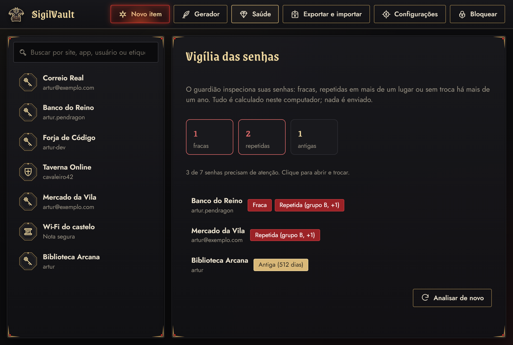
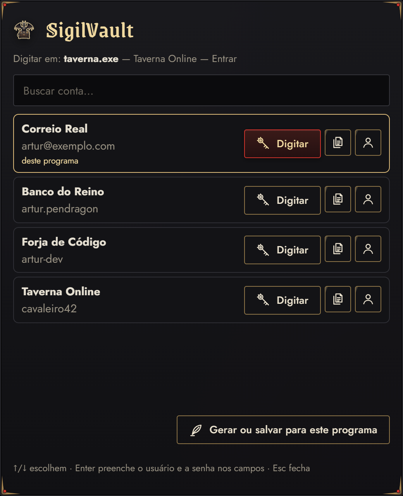
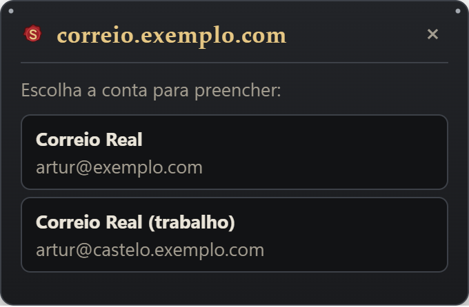
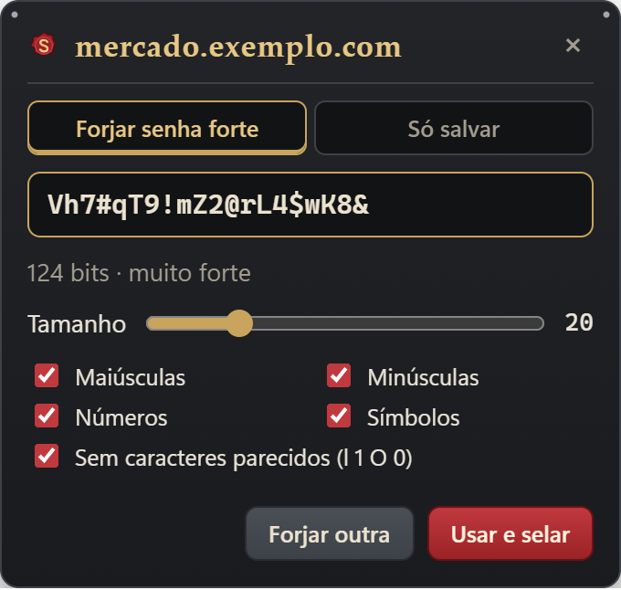
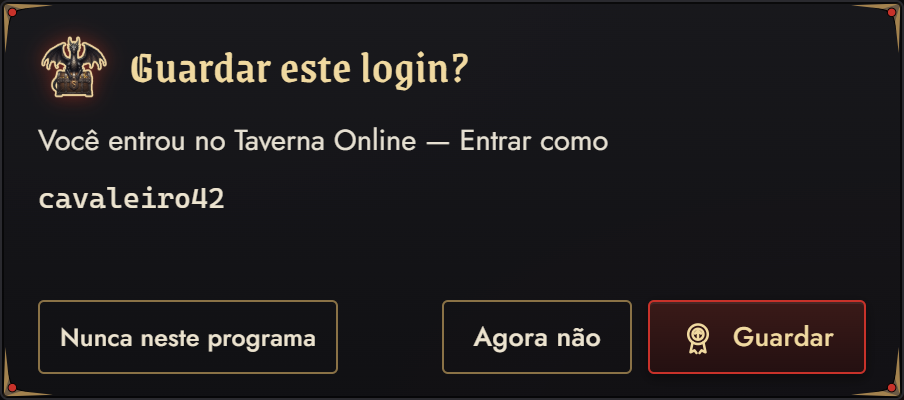

# SigilVault

🇧🇷 [Português](#português) · 🇺🇸 [English](#english)

**⬇️ [Baixar a versão mais recente / Download the latest version](https://github.com/jonataspxavier-dev/sigilvault/releases)** · [Como instalar / How to install](docs/INSTALAR.md)

<p align="center"></p>

| | |
| :---: | :---: |
| <br>**Cofre / Vault** | <br>**Forja de senhas / Password forge** |
| <br>**Vigília das senhas / Password watch** | <br>**Busca rápida nos programas / Quick search in programs** |
| <br>**Extensão: preencher / Extension: fill** | <br>**Extensão: forjar senha / Extension: forge a password** |
| <br>**"Guardar este login?" / "Keep this login?"** | |

<sub>Telas com dados de exemplo. / Screens with sample data.</sub>

---

## Português

**SigilVault** é um gerenciador de senhas **local** para Windows. Ele guarda tudo criptografado no próprio computador, preenche senhas no navegador e em apps desktop e gera senhas fortes. Nada vai para a nuvem, a menos que você escolha.

> Status: **Fase 7 em andamento**: instalador por máquina, memória travada, relatório de saúde e endurecimento prontos. Para instalar (versão de testes), baixe o instalador em [Releases](https://github.com/jonataspxavier-dev/sigilvault/releases) e siga o [guia de instalação](docs/INSTALAR.md).

### Visão geral

- **Segurança em primeiro lugar:** os dados só são descriptografados na memória, na hora de usar.
- **Local-first:** sem servidor, sem conta online e sem telemetria.
- **Leve:** um serviço na bandeja do Windows de ~10–20 MB; a janela só é carregada quando aberta.
- **Senhas fortes como hábito:** toda senha nova nasce do gerador.
- **Identidade própria:** nome, ícones e visual 100% originais, com estilo medieval nórdico.

### Arquitetura

```
Extensão do navegador ──Native Messaging (pareado)──► Serviço da bandeja ──► Núcleo Rust ──► cofre.sigil
Apps desktop ◄──────────── Auto-Type (atalho) ─────── Janela Tauri (só quando aberta)
```

| Pasta | Conteúdo |
| --- | --- |
| [`core/`](core/) | Núcleo em Rust: cofre, criptografia, slots de chave, códigos de recuperação e gerador. É o **único** componente que descriptografa. |
| [`app/`](app/) | App desktop em Tauri 2 + TypeScript (Fase 2). |
| [`extension/`](extension/) | Extensão WebExtensions MV3 para Chrome, Brave, Opera e Firefox (Fase 4). |
| [`crates/pairing/`](crates/pairing/) | Pareamento OPAQUE e canal criptografado, usado pelo app e (em WebAssembly) pela extensão. |
| [`crates/ipc/`](crates/ipc/) | Pipe protegido entre o app e o host, e verificação do executável do outro lado (caminho e Authenticode). |
| [`crates/native-host/`](crates/native-host/) | `sigilvault-host.exe`: o programa que o navegador abre; só repassa mensagens criptografadas. |
| [`crates/locked/`](crates/locked/) | Chaves do cofre em memória travada (`VirtualLock`), fora do arquivo de paginação. |
| [`docs/`](docs/) | [Planejamento completo](docs/PLANEJAMENTO.md). |

### Modelo de segurança

- **Senha mestra → chave:** Argon2id (padrão de 128 MiB e 3 passadas; mínimos obrigatórios ao abrir o cofre).
- **Chave do cofre:** 256 bits aleatórios, guardados criptografados em *slots*: um pela senha mestra e um por código de recuperação.
- **Dados:** XChaCha20-Poly1305 (criptografia autenticada). O cabeçalho inteiro é autenticado, e cada senha fica amarrada ao ID do seu item (AAD).
- **10 códigos de recuperação** de uso único, com 130 bits cada (base32 + dígito verificador). Usar um código troca a chave do cofre e recriptografa tudo.
- **Aleatoriedade:** sempre o gerador seguro do sistema operacional.
- **Bibliotecas:** apenas as auditadas do ecossistema RustCrypto. Nada de criptografia própria.
- **Protege contra:** roubo do PC ou do disco, vazamento do arquivo ou do backup, phishing e vazamento de nuvem.
- **Preenchimento no navegador:** só com clique; origem completa (protocolo + domínio + porta), subdomínios só se você permitir no item, e nunca de `https` para `http`. A origem vem do navegador, e o app confere de novo. O primeiro preenchimento em cada site pede confirmação no app; formulários dentro de outro site perguntam sempre. Ícone e balão num iframe da extensão que a página não lê; cliques só reais, depois de 500 ms visíveis. Registro de preenchimentos e limite de frequência. Senhas trocadas vão para o histórico.
- **Auto-Type (desktop):** só por atalho seu; reconhece o programa pelo executável e pela assinatura (nunca pelo título); não digita em navegadores nem em janelas de administrador; confere a janela antes de cada bloco e para se ela mudar; digitação Unicode (acentos do ABNT2). O pop-up tem permissões mínimas.
- **Extensão ↔ app:** Native Messaging (sem porta de rede) → `sigilvault-host.exe` → named pipe só do seu usuário. Cada lado confere o executável do outro. Pareamento OPAQUE com código mostrado no app; depois, canal AES-256-GCM por conexão. A extensão nunca guarda senhas.
- **Instalação protegida:** sem certificado de assinatura, o app e o conector só confiam um no outro se estiverem na mesma pasta que o usuário comum não altera (Program Files). Com certificado, a assinatura também é exigida.
- **Processo:** chaves do cofre em memória travada; fora dos relatórios de erro do Windows; DLLs só da pasta do programa e do System32; Control Flow Guard; WebView2 sem SmartScreen, conexões de fundo nem relatórios de falha.
- **Não protege contra:** malware ou keylogger rodando enquanto o cofre está desbloqueado.

### Fases

1. Núcleo em Rust + testes ✅
2. App desktop (Tauri): criar e desbloquear o cofre, CRUD, gerador, bandeja e bloqueio automático ✅
3. Exportar e importar, backups locais e importação de outros gerenciadores ✅
4. Extensão + Native Messaging com pareamento seguro ✅
5. Navegador completo: preencher, balão "gerar ou só salvar" e aviso de salvar ✅
6. Desktop completo: atalhos globais, pop-up de busca e Auto-Type ✅
7. **Endurecimento e lançamento:** instalador por máquina, memória travada, iniciar com o Windows, relatório de saúde e revisão de segurança ← *em andamento* (Windows Hello, assinatura e lojas ficam para depois)

### Desenvolvimento

```powershell
cargo test --workspace          # testes do núcleo e do app (Rust)
cd app; npm install; npm test   # testes da interface
cd extension; npm install; npm test; npm run build   # extensão (veja extension/README.md)
npx tauri dev                   # abre o app em modo de desenvolvimento
npx tauri build                 # instalador (target\release\bundle\nsis)
```

Requisitos: Rust estável (rustup), Node.js LTS e Visual Studio Build Tools com C++.

---

## English

**SigilVault** is a **local** password manager for Windows. It keeps everything encrypted on your own computer, fills passwords in the browser and in desktop apps, and generates strong passwords. Nothing goes to the cloud unless you choose so.

> Status: **Phase 7 in progress**: per-machine installer, locked memory, health report and hardening are done. To install (test build), download the installer from [Releases](https://github.com/jonataspxavier-dev/sigilvault/releases) and follow the [install guide](docs/INSTALAR.md#english).

### Overview

- **Security first:** data is decrypted only in memory, only when needed.
- **Local-first:** no server, no online account, no telemetry.
- **Lightweight:** a ~10–20 MB Windows tray service; the window loads only when opened.
- **Strong passwords by habit:** every new password comes from the generator.
- **Own identity:** 100% original name, icons and look, in a Nordic medieval style.

### Architecture

```
Browser extension ──Native Messaging (paired)──► Tray service ──► Rust core ──► cofre.sigil
Desktop apps ◄──────────── Auto-Type (hotkey) ── Tauri window (only when open)
```

| Folder | Contents |
| --- | --- |
| [`core/`](core/) | Rust core: vault, cryptography, key slots, recovery codes and generator. It is the **only** component that decrypts. |
| [`app/`](app/) | Tauri 2 + TypeScript desktop app (Phase 2). |
| [`extension/`](extension/) | MV3 WebExtension for Chrome, Brave, Opera and Firefox (Phase 4). |
| [`crates/pairing/`](crates/pairing/) | OPAQUE pairing and encrypted channel, used by the app and (as WebAssembly) by the extension. |
| [`crates/ipc/`](crates/ipc/) | Protected pipe between the app and the host, and checks of the executable on the other side (path and Authenticode). |
| [`crates/native-host/`](crates/native-host/) | `sigilvault-host.exe`: the program the browser starts; it only relays encrypted messages. |
| [`crates/locked/`](crates/locked/) | Vault keys in locked memory (`VirtualLock`), kept out of the page file. |
| [`docs/`](docs/) | [Full plan (Portuguese)](docs/PLANEJAMENTO.md). |

### Security model

- **Master password → key:** Argon2id (default 128 MiB and 3 passes; minimums enforced when opening a vault).
- **Vault key:** 256 random bits, stored encrypted in *slots*: one for the master password and one per recovery code.
- **Data:** XChaCha20-Poly1305 (authenticated encryption). The whole header is authenticated, and each password is bound to its item ID (AAD).
- **10 single-use recovery codes**, 130 bits each (base32 + check digit). Using a code rotates the vault key and re-encrypts everything.
- **Randomness:** always the operating system's secure RNG.
- **Libraries:** only audited RustCrypto crates. No home-made cryptography.
- **Protects against:** stolen PC or disk, leaked file or backup, phishing and cloud leaks.
- **Browser filling:** click only; full origin (scheme + domain + port), subdomains only if you allow them on the item, and never from `https` to `http`. The origin comes from the browser, and the app checks it again. The first fill on each site asks for confirmation in the app; forms inside another site always ask. Icon and balloon in an extension iframe the page cannot read; real clicks only, after 500 ms on screen. Fill log and rate limit. Changed passwords go to the history.
- **Auto-Type (desktop):** only on your hotkey; recognizes the program by executable and signature (never by title); never types into browsers or administrator windows; checks the window before each block and stops if it changed; Unicode typing. The popup has minimal permissions.
- **Extension ↔ app:** Native Messaging (no network port) → `sigilvault-host.exe` → a named pipe for your user only. Each side checks the other's executable. OPAQUE pairing with a code shown in the app; then an AES-256-GCM channel per connection. The extension never stores passwords.
- **Protected install:** without a signing certificate, the app and the connector only trust each other when they sit in the same folder a normal user cannot change (Program Files). With a certificate, the signature is required too.
- **Process:** vault keys in locked memory; excluded from Windows Error Reporting; DLLs only from the program folder and System32; Control Flow Guard; WebView2 without SmartScreen, background connections or crash reports.
- **Does not protect against:** malware or keyloggers running while the vault is unlocked.

### Phases

1. Rust core + tests ✅
2. Desktop app (Tauri): create and unlock the vault, CRUD, generator, tray and auto-lock ✅
3. Export and import, local backups and import from other managers ✅
4. Extension + Native Messaging with secure pairing ✅
5. Full browser support: fill, "generate or just save" popup and save prompt ✅
6. Full desktop support: global hotkeys, search popup and Auto-Type ✅
7. **Hardening and release:** per-machine installer, locked memory, start with Windows, health report and security review ← *in progress* (Windows Hello, signing and stores come later)

### Development

```powershell
cargo test --workspace          # core and app tests (Rust)
cd app; npm install; npm test   # UI tests
cd extension; npm install; npm test; npm run build   # extension (see extension/README.md)
npx tauri dev                   # opens the app in development mode
npx tauri build                 # installer (target\release\bundle\nsis)
```

Requirements: stable Rust (rustup), Node.js LTS and Visual Studio Build Tools with C++.
